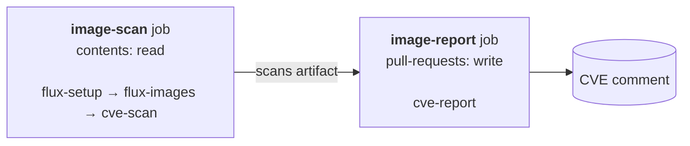

# gitops-actions

[](https://github.com/mydoomfr/gitops-actions/actions/workflows/ci.yaml)
[](https://github.com/mydoomfr/gitops-actions/actions/workflows/e2e.yaml)
[](LICENSE)

**See what a [Flux](https://fluxcd.io) pull request really changes, before you merge it.**
Right in CI and fully standalone: no cluster, no kubeconfig, no agent to install.

> [!IMPORTANT]
> **Flux only.** The Helm diff and the image discovery read Flux objects
> (`Kustomization`, `HelmRelease`, `OCIRepository`, `HelmRepository`...) and render them
> with [flate](https://github.com/home-operations/flate), an offline Flux renderer.
> Argo CD, Helmfile, plain Helm or Kustomize repositories are **not** supported.
> The only exception is the CVE diff of an image built by the pull request
> (`cve-scan` + `cve-report`), which works in any repository.

Composite GitHub Actions that comment on every pull request, Renovate ones included:

- 📦 **Helm diff**: the real render of every HelmRelease the pull request touches,
  chart n-1 with the old values against chart n with the new values.
- 🛡️ **CVE diff**: for every container image the pull request changes, the
  vulnerabilities of the old and new image side by side, then the High/Critical CVEs
  (configurable) of the new image, those the change adds flagged 🆕, and those it
  fixes. Scanned by [grype](https://github.com/anchore/grype).
- 🔐 **SOPS without the key**: encrypted Helm values are rendered with placeholders, so
  CI never needs the private key.

Each comment is updated on every push. When nothing is left to report, an existing
comment says so, and no new one is created.

## Preview

Example: a pull request that upgrades the traefik chart (42.3.2 → 42.4.0) and its
image (v3.7.17 → v3.7.18, pinned by digest), and enables its PodDisruptionBudget.

<details open><summary><b>CVE diff</b></summary>

> ### Image CVEs (abcdef0)
>
> | Image | Version | Critical | High | Medium | Low | Fixable |
> |---|---|---|---|---|---|---|
> | `docker.io/traefik` | `v3.7.17@f4bb143` → `v3.7.18@9c437ac` | 0 | 2 → 1 ✅ | 4 | 1 | 2 → 1 ✅ |
>
> <details open><summary><code>docker.io/traefik</code>: 1 High/Critical, 1 fixable, 1 added, 2 fixed</summary>
>
> | CVE | Severity | Packages | Version | Fixed in |
> |---|---|---|---|---|
> | 🆕 CVE-0000-0004 | High | `golang.org/x/net` | `v0.47.0` | 0.48.0 |
>
> **Fixed**
>
> | CVE | Severity | Packages | Version | Fixed in |
> |---|---|---|---|---|
> | CVE-0000-0001 | High | `stdlib` | `go1.25.4` | 1.25.5 |
> | CVE-0000-0002 | High | `zlib` | `1.3.1-r2` | 1.3.2-r0 |
>
> </details>

</details>

<details open><summary><b>Helm diff</b></summary>

> ### Rendered HelmRelease diff (abcdef0)
>
> | HelmRelease | Chart | Added | Changed | Removed |
> |---|---|--:|--:|--:|
> | `flux-system/traefik` | `traefik` 42.3.2 → 42.4.0 | 1 | 1 | |
>
> <details open><summary><code>flux-system/traefik</code>: 1 added, 1 changed</summary>
>
> ```diff
> --- Deployment traefik/traefik
> +++ Deployment traefik/traefik
> @@ -9,3 +9,3 @@
>  spec:
> -  replicas: 1
> +  replicas: 2
>    revisionHistoryLimit: 10
> @@ -44,3 +44,5 @@
>              - --providers.kubernetesgateway.gatewayClass=traefik
> +            - --entryPoints.web.transport.lifeCycle.requestAcceptGraceTimeout=5s
>              - --entryPoints.websecure.http.tls=true
> +            - --entryPoints.websecure.transport.lifeCycle.requestAcceptGraceTimeout=5s
>              - --log.level=INFO
> @@ -63,4 +65,4 @@
>              - name: USER
>                value: traefik
> -          image: docker.io/traefik:v3.7.17@sha256:f4bb143d1135a579b630ed491e17ec50f6f7c9c6a30585ff3d385471d2a86f5a
> +          image: docker.io/traefik:v3.7.18@sha256:9c437ac4f09ce6f4980a8544902d3475fdf70a1a7c578729581d2535dfa7d635
>            imagePullPolicy: IfNotPresent
> --- PodDisruptionBudget traefik/traefik
> +++ PodDisruptionBudget traefik/traefik
> @@ -0,0 +1,11 @@
> +apiVersion: policy/v1
> +kind: PodDisruptionBudget
> +metadata:
> +  name: traefik
> +  namespace: traefik
> +spec:
> +  maxUnavailable: 1
> +  selector:
> +    matchLabels:
> +      app.kubernetes.io/name: traefik
> +      app.kubernetes.io/instance: traefik-traefik
> ```
>
> </details>

</details>

## A diff of what your cluster will run

Review a chart bump by the manifests **your values** produce, not by the chart's
changelog or templates. flate renders each HelmRelease twice, as Flux's
helm-controller would, with the chart, the inline values and the `valuesFrom` of each
side, then diffs the resulting objects:

- If your values set `grafana.enabled: false` and chart n rewrites its Grafana
  templates, the diff stays empty: nothing changes in your cluster.
- A new chart default you don't override shows up; one you override doesn't.
- A values-only change, with no chart bump, is rendered the same way.

Labels and annotations that change with every chart version (`helm.sh/chart`,
`app.kubernetes.io/version`, `checksum/*`) are ignored as noise. `Secret` and
`CustomResourceDefinition` objects are left out by default, see
[Charts using CRDs](#charts-using-crds).

## SOPS without the private key

SOPS encrypts values, never keys: the structure of an encrypted values file stays
readable. `flux-setup` keeps that structure and swaps each encrypted leaf for a
placeholder of the same type, so the chart renders without decryption:

```yaml
# values.enc.yaml in the repository          # what flate renders
auth:                                         auth:
  password: ENC[AES256_GCM,...,type:str]        password: "# sops-redacted"
  existingSecretName: ENC[...,type:str]         existingSecretName: sops-redacted
persistence:                                  persistence:
  enabled: ENC[AES256_GCM,...,type:bool]        enabled: true
replicas: ENC[AES256_GCM,...,type:int]        replicas: 1
```

Strings become `# sops-redacted`, a YAML comment wherever a chart inlines it, except
keys ending in `name` that may end up in `metadata.name`, which get a valid DNS label.
Since both sides get the same placeholders, a change to an encrypted value is not
shown, and an encrypted `false` renders as `true`. The files are matched by the
`sops-values-pattern` input (`*values.enc.yaml`).

## Charts using CRDs

Many charts render an object only when the cluster serves its API, such as
`{{ if .Capabilities.APIVersions.Has "monitoring.coreos.com/v1" }}` around a
`ServiceMonitor`. There is no cluster here, so flate only knows the APIs listed in the
`api-versions` input of `flux-setup`. If an API is missing, its objects silently drop
out of the render.

The default covers Prometheus Operator, Gateway API, cert-manager and VolumeSnapshot.
The input **replaces** that list, so repeat the defaults when you add an API:

```yaml
- uses: mydoomfr/gitops-actions/flux-setup@<sha> # v1.1.0
  with:
    api-versions: >-
      monitoring.coreos.com/v1 monitoring.coreos.com/v1alpha1
      gateway.networking.k8s.io/v1 cert-manager.io/v1 snapshot.storage.k8s.io/v1
      external-secrets.io/v1
```

The `CustomResourceDefinition` objects themselves are left out of the Helm diff by
flate. To review a chart's CRD changes too, override flate's excluded kinds at the
job level and keep only `Secret`:

```yaml
  helm-diff:
    env:
      FLATE_SKIP_KINDS: Secret
```

## Quick start: Flux repository

Copy [`examples/flux-pr.yaml`](examples/flux-pr.yaml) to `.github/workflows/`, set
`path` to the directory holding your cluster's Flux bootstrap objects, and pin the
actions to a release SHA. Drop a job to turn its feature off.

```yaml
jobs:
  helm-diff:
    runs-on: ubuntu-latest
    permissions:
      contents: read
      pull-requests: write
    steps:
      - uses: mydoomfr/gitops-actions/flux-setup@<sha> # v1.1.0
      - uses: mydoomfr/gitops-actions/helm-diff@<sha> # v1.1.0
        with:
          path: clusters/my-cluster

  image-scan: # read-only: the scanner pulls third-party images
    runs-on: ubuntu-latest
    permissions:
      contents: read
    steps:
      - uses: mydoomfr/gitops-actions/flux-setup@<sha> # v1.1.0
      - uses: mydoomfr/gitops-actions/flux-images@<sha> # v1.1.0
        id: images
        with:
          path: clusters/my-cluster
      - uses: mydoomfr/gitops-actions/cve-scan@<sha> # v1.1.0
        with:
          targets: ${{ steps.images.outputs.targets }}
          notes: ${{ steps.images.outputs.notes }}

  image-report:
    needs: image-scan
    runs-on: ubuntu-latest
    permissions:
      pull-requests: write
    steps:
      - uses: mydoomfr/gitops-actions/cve-report@<sha> # v1.1.0
```



The scanner pulls third-party images, so it never holds a token that can write.

## Quick start: any repository building images

Scan the image a pull request builds against the published one. One `cve-scan` job
per image, one `cve-report` job merging them into a single comment:

```yaml
  cves:
    needs: build
    runs-on: ubuntu-latest
    permissions:
      contents: read
    steps:
      - uses: actions/download-artifact@<sha> # the image saved by the build job
        with:
          name: my-app-image
          path: ${{ runner.temp }}
      - uses: mydoomfr/gitops-actions/cve-scan@<sha> # v1.1.0
        with:
          name: my-app
          new-source: docker-archive:${{ runner.temp }}/image.tar
          new-label: 1.2.0
          old-source: registry:ghcr.io/me/my-app:1.1.0
          old-label: 1.1.0
          artifact-name: my-app-cves

  cve-comment:
    needs: cves
    runs-on: ubuntu-latest
    permissions:
      pull-requests: write
    steps:
      - uses: mydoomfr/gitops-actions/cve-report@<sha> # v1.1.0
        with:
          artifact-pattern: "*-cves"
          name-header: App
```

Sources are [grype sources](https://github.com/anchore/grype#supported-sources), such
as `registry:` or `docker-archive:`.

## Actions

| Action | What it does |
|---|---|
| [`flux-setup`](flux-setup/action.yml) | Checks out the pull request in `./pr` and its base in `./base`, replaces SOPS values with placeholders, installs flate. |
| [`helm-diff`](helm-diff/action.yml) | Renders the HelmRelease diff and comments it. Needs `pull-requests: write`. |
| [`flux-images`](flux-images/action.yml) | Lists the images the pull request changes, each paired with the image it replaces. |
| [`cve-scan`](cve-scan/action.yml) | Scans each new image and the one it replaces, uploads the scans as an artifact. Run it read-only. |
| [`cve-report`](cve-report/action.yml) | Downloads the scans and comments the CVE report. Needs `pull-requests: write`. |
| [`pr-comment`](pr-comment/action.yml) | Creates or updates the comment tagged with a marker. Needs `pull-requests: write`. |

<details><summary><b>Inputs</b></summary>

**flux-setup**

| Input | Default | Description |
|---|---|---|
| `sops-values-pattern` | `*values.enc.yaml` | `find -name` pattern of the SOPS-encrypted Helm values; empty to leave them encrypted |
| `api-versions` | Prometheus Operator, Gateway API, cert-manager, VolumeSnapshot | CRD API versions offline helm reports as available, see [Charts using CRDs](#charts-using-crds) |

**helm-diff**

| Input | Default | Description |
|---|---|---|
| `path` | required | Cluster directory holding the Flux bootstrap objects |
| `marker` | `helm-diff` | Tag of the comment |
| `max-chars` | `60000` | Size above which a diff is replaced by a link to the run summary |
| `token`, `author` | workflow token, `github-actions[bot]` | Identity that writes the comment |

**flux-images** (outputs: `targets`, `notes`)

| Input | Default | Description |
|---|---|---|
| `path` | required | Cluster directory holding the Flux bootstrap objects |
| `max-images` | `20` | Images listed at most, the others are counted in the notes |

**cve-scan** (output: `dir`)

| Input | Default | Description |
|---|---|---|
| `targets` | | JSON file of `[{name, new_label, new_source, old_label?, old_source?}]`, as `flux-images` writes it |
| `name`, `new-source`, `new-label`, `old-source`, `old-label` | | Single image mode, instead of `targets` |
| `notes` | | Markdown file shown above the report table |
| `platform` | `linux/amd64` | Platform scanned for multi-arch images |
| `cache-db` | `false` | Keep the grype database in the Actions cache |
| `output-dir` | `$RUNNER_TEMP/cve-scans` | Directory receiving the scans |
| `artifact-name` | `cve-scans` | Artifact holding the scans, empty to skip the upload |

**cve-report**

| Input | Default | Description |
|---|---|---|
| `artifact-pattern` | `cve-scans` | Artifacts to download, empty when the scans are local |
| `scans-dir` | `$RUNNER_TEMP/cve-scans` | Directory holding the scans |
| `marker` | `image-cves` | Tag of the comment |
| `title`, `name-header`, `intro` | `Image CVEs`, `Image`, default line | Comment heading, first column header, line under the heading |
| `noop-message` | `No image change as of {sha}.` | Refreshes an existing comment when there is nothing to report |
| `platform` | `linux/amd64` | Platform named in the default intro |
| `severities` | `Critical,High` | Severities listed in detail and counted as fixable |
| `max-rows` | `30` | Rows per CVE table in the comment; the run summary keeps them all |
| `max-chars` | `60000` | Size above which the lists are replaced by a link to the run summary |
| `token`, `author` | workflow token, `github-actions[bot]` | Identity that writes the comment |

**pr-comment**

| Input | Default | Description |
|---|---|---|
| `marker` | required | Unique tag of the comment, stored as a hidden HTML comment |
| `body-file` | required | Markdown file holding the comment body |
| `update-only` | `false` | Only refresh an existing comment, never create one |
| `token`, `author` | workflow token, `github-actions[bot]` | Identity that writes the comment |

</details>

## Security

- **The scanner never holds a writable token.** `cve-scan` pulls third-party images, so
  it runs in a read-only job; `cve-report` posts from a separate job that never touches
  an image.
- **No secret in CI.** SOPS values are swapped for placeholders, never decrypted.
- **Pinned dependencies.** Every third-party action is pinned by commit SHA; pin this
  repository the same way.

## Limits

- Flux only, see above. The render is offline: Helm `lookup` returns nothing, and the
  cluster capabilities are flate's Kubernetes version plus the `api-versions` input.
- The Helm diff covers HelmReleases. Plain Kustomization manifests are reviewed in the
  pull request diff itself, and their images are still scanned.
- Images are read from `image` and `imageName` fields. A custom resource that splits
  an image into `repository` and `tag` fields is not scanned.
- Pull request events only: the base is the first parent of the merge commit.
- Private registries need credentials grype can read, such as a `docker login` in the
  scan job.

## Development

`tests/run.sh` runs the scripts of `lib/` against fixtures, with fake `grype` and `gh`
binaries.

The `e2e` workflow renders a fixture Flux change (`tests/e2e/fixtures`) with the flate
version pinned in `flux-setup`, and checks the images and HelmReleases it must find
against `tests/e2e/expected`. It runs on every pull request that touches the Flux
actions, so a flate bump that changes the renders fails its Renovate pull request.

Renovate keeps the action SHAs (`helpers:pinGitHubActionDigests`) and the flate version
up to date.

## License

[MIT](LICENSE)
